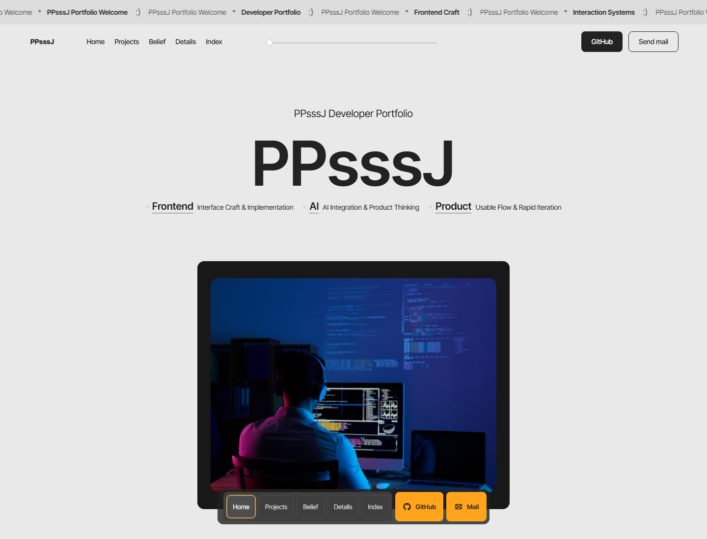

<p align="center">
  
</p>

# PPsssJ Developer Portfolio

Software engineering portfolio focused on web applications, developer tools, and end-to-end product development, built with React, TypeScript, and Vite.

## Live Site

https://ppsssj.vercel.app/

## Preview



## About

PPsssJ is a personal portfolio for a software engineer building applications and developer tools across the browser, editor, and desktop. It presents product thinking, frontend architecture, visualization, system integration, published extensions, activity history, and awards.

## Tech Stack

- React
- TypeScript
- Vite
- Framer Motion
- CSS
- Electron
- VS Code Extension API
- Chrome Extension MV3
- Three.js / React Three Fiber
- ReactFlow / Canvas 2D
- Node.js / Express

## Featured Projects

- InfiniteDesk
- Cogic
- GraphMind
- PrismDesign
- Traffic Noise Prediction System
- Git Reflow
- Git Effects

## Run Locally

```bash
npm install
npm run dev
```

## Build

```bash
npm run build
```
